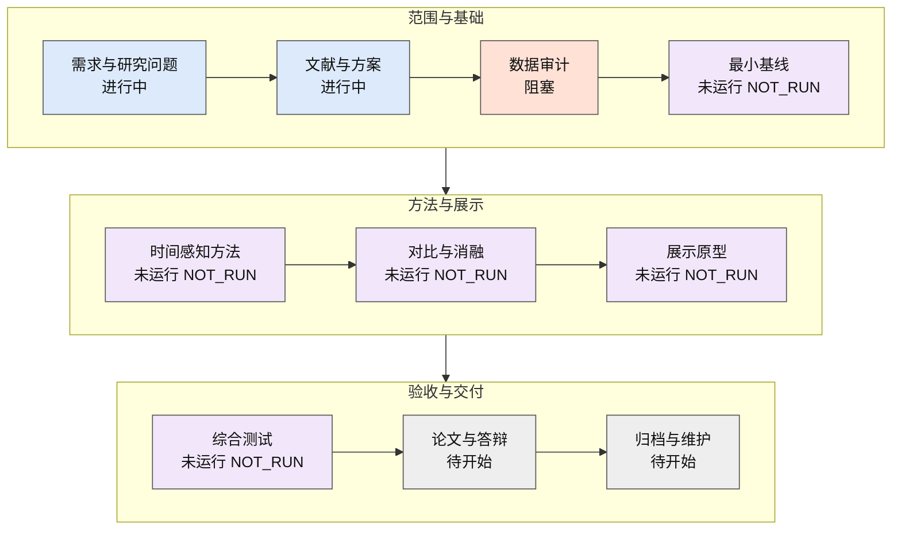

# 时间感知网络流量异常检测

本仓库管理“面向动态网络环境的时间感知流量异常检测方法研究”的技术文档、研究资料、程序源码和实验记录。目标是研究近期历史信息对异常检测误报、攻击识别和运行成本的影响，并形成可复核的实验与单机展示原型。


<!-- PROJECT-PROGRESS:START -->
## 项目当前进度

最近更新：**2026-10-23**。当前阶段：**数据审计**；本轮主题：作者修订版对象和有界方案已核；隔离审计人工验证通过，载荷获取未批准，Data Gate保持BLOCKED。



文字与颜色共同表示状态：已完成、进行中、待开始、阻塞、未运行。流程表示依赖顺序，部分文档与测试工作可交叉推进。

| 阶段 | 状态 | 已完成/总验收项 | 证据入口 | 下一步 |
|---|---|---|---|---|
| 需求与研究问题 | 进行中 | 1/3 | [清单与证据](<docs/project/ROADMAP.md>) | 用户选择C可行性方向；具体主数据/表示与导师审阅仍待登记 |
| 文献与方案 | 进行中 | 1/3 | [清单与证据](<docs/README.md>) | 精读并核对方法差异 |
| 数据审计 | 阻塞 | 1/4 | [清单与证据](<docs/project/DATA-GATE-2026-10-21.md>) | 按C核查候选发行物及四段供给；原UGR阻塞保持，不把方向决定当Data Gate通过 |
| 最小基线 | 未运行 NOT_RUN | 0/4 | [清单与证据](<src/README.md>) | 合成核心已在W1交付；真实最小基线等待Data Gate |
| 时间感知方法 | 未运行 NOT_RUN | 0/4 | [清单与证据](<src/README.md>) | 依基线证据确定窗口 |
| 对比与消融 | 未运行 NOT_RUN | 0/4 | [清单与证据](<experiments/README.md>) | 冻结统一评价协议 |
| 展示原型 | 未运行 NOT_RUN | 0/4 | [清单与证据](<src/README.md>) | 合成CLI/API/网页回放与导出一致；真实联调待Data Gate，研究验收不升级 |
| 综合测试 | 未运行 NOT_RUN | 0/3 | [清单与证据](<tests/README.md>) | 实现后风险契约验收 |
| 论文与答辩 | 待开始 | 0/3 | [清单与证据](<docs/README.md>) | 基于实验证据撰写 |
| 归档与维护 | 待开始 | 0/3 | [清单与证据](<docs/project/ROADMAP.md>) | 交付后复核版本清单 |

计数口径：2026-10-11阶段验收清单v1；按证据是否满足计数，维护工具测试不计入研究或业务验收。各项条件与证据见[状态源](docs/project/status.json)；文档存在不等于实现或实验通过。不合并为总体百分比；范围变化须登记新分母及原因。

**本次完成事项**

- 从07e5cf2续接，用户明确作者CICIDS2017_improved优先审计、原Generated镜像备选；不再询问A/B/C或优先级。
- 作者来源链及唯一HEAD核得ZIP343549013字节；ETag/Last-Modified已记，作者校验/解压量/精确生成绑定未知，新增数据载荷0字节。
- 隔离审计新增48项测试；含58项数据审计的Python回归187项及34个subtests通过，仓库13项通过；均不构成真实数据证据。
- 四段与正常高完成流组实际计数仍null；主数据采用、生产迁移未批准，真实拟合/联调和正式实验NOT_RUN。

**当前阻塞或待验证事项**

- 作者improved获取尚未获对象与预算的明确批准，载荷未取得；成员/解压规模及本地SHA待获准下载后检查。
- 修订包实际字段/时间/单位与生成绑定未审；上游dropna覆盖、Attempted政策、四段及正常高完成流供应仍未知。
- improved优先是审计决定，主数据/表示正式采用与生产迁移未批准；旧09—17源钟面不能直接改UTC。
- UGR正常测试分母0及旧时间/许可阻塞保持；准备工具与合成CI不能解除Data Gate。

**接下来最重要的三项任务**

1. [C-I1](<docs/research/2026-10-23-c17-improved-preparation.md>)：审阅单对象343549013字节的C17-I1预算，独立批准后才获取；当前停在ZIP载荷前。
2. [C-I2](<docs/guides/c17-improved-audit.md>)：获准取得后先本地ZIP目录安全检查，按显式字段/时间/覆盖依据审计；Attempted三方案保留待决，禁止拟合。
3. [C-I3](<docs/project/CANDIDATE-DATA-DECISION-2026-10-23.md>)：核四段/H15,H30共同资格及训练Q90固定测试子组；供应不足先给协议修订代价，再决定主数据/迁移。

**最新成果入口**

- [作者修订版获取方案、字段时间适配与Attempted待决](<docs/research/2026-10-23-c17-improved-preparation.md>)
- [隔离审计工具、合成验证和下一完整提示](<docs/guides/c17-improved-audit.md>)
- [CICIDS2017适配性、样本风险与审计取舍](<docs/research/2026-10-23-cicids-suitability-analysis.md>)
- [GitHub数据来源检索与可获取镜像元信息](<docs/research/2026-10-23-github-dataset-search.md>)
- [C17官方入口、生成版本与C18-S本地一致性复核](<docs/research/2026-10-23-c17-source-metadata.md>)
- [10月23日C方向具体数据与表示决定包](<docs/project/CANDIDATE-DATA-DECISION-2026-10-23.md>)
- [CIC发行物、许可、时间与标签证据](<docs/research/2026-10-23-cic-candidate-evidence.md>)
- [候选文件、资源上限与未审计计数清单](<docs/research/2026-10-23-candidate-manifest.json>)
- [研究协议A/B/C对照与用户已选C方向](<docs/project/RESEARCH-PROTOCOL-OPTIONS.md>)
- [10月22日增量证据与候选元数据](<docs/research/2026-10-22-data-gate-evidence-update.md>)
- [Data Gate本轮分项判定与待决方案](<docs/project/DATA-GATE-2026-10-21.md>)
- [真实短片段准备与下一阶段完整提示](<docs/guides/real-validation-preflight.md>)
- [标签、时间与来源许可核查](<docs/research/2026-10-21-data-gate-label-audit.md>)
- [W0合成CLI/API/网页/导出联调证据](<docs/project/W0-SYNTHETIC-INTEGRATION-2026-10-21.md>)
- [合成系统快速运行](<docs/guides/quickstart.md>)
- [UGR16v3来源、标签与时区核验](<docs/research/2026-10-21-UGR16v3-provenance.md>)
- [W0三个模块交付接收与Data Gate复核](<docs/project/W0-DELIVERY-ACCEPTANCE-2026-10-21.md>)
- [W0-01契约交接与开发环境](<docs/project/W0-01-HANDOFF.md>)
- [并行开发计划V1.0与各work启动提示](<docs/superpowers/plans/2026-10-21-parallel-development.md>)
- [开题报告V0.40公开文本（15页、完整10图）](<docs/reports/开题报告-V0.40-公开文本.md>)
- [V0.40学习手册与十图讲解](<docs/reports/开题报告-V0.40-学习与答辩准备手册.md>)
- [答辩V0.24与讲稿、答疑（16页主讲）](<docs/reports/开题答辩-V0.24-公开文本.md>)
- [业务问题与研究主线及版本关系](<docs/reports/开题答辩-V0.24-结构与版本记录.md>)
- [W1交付、命令、真实审计与NOT_RUN边界](<experiments/W1-HANDOFF.md>)
- [滚动路线图、任务验收与依赖](<docs/project/ROADMAP.md>)
- [W2-01后端运行与验证说明（SYNTHETIC_ONLY）](<src/backend/README.md>)
- [W3前端安装、验证与NOT_RUN清单](<src/frontend/README.md>)

业务可运行版本与演示：**尚无，NOT_RUN**。仓库维护工具的可运行入口见[工具说明](tools/README.md)。远端自动检查以工作流徽章和实际运行记录为准；本轮提交前为**待远端检查**。
<!-- PROJECT-PROGRESS:END -->

## 从哪里开始

- [文档导航](docs/README.md)：最新报告、答辩稿、设计基线及研究资料。
- [项目规划](docs/project/ROADMAP.md)：两周任务、中期里程碑与半年以上滚动路线。
- [状态源](docs/project/status.json)：阶段验收条件、已满足项与证据；首页进度由此生成。
- [决策与方案差异](docs/project/DECISIONS.md)：当前提案、历史基线和待确认影响。
- [风险与阻塞](docs/project/RISKS.md)：优先级、解除条件和处理任务。
- [仓库文件管理](docs/project/REPOSITORY_LAYOUT.md)：各分区职责及本地材料的入库方式。
- [开发与提交规范](CONTRIBUTING.md)：使用 GitHub Desktop 提交、推送和维护。
- [隐私与发布规则](docs/project/PRIVACY.md)：正文、文件名、元数据及提交身份检查。
- [变更记录](CHANGELOG.md)：已完成的仓库维护工作。

## 仓库分区

```text
docs/                 可发布技术文档、报告文本、研究资料和图形源文件
  project/            项目规划、状态、仓库管理和发布规则
  reports/            当前报告与答辩的脱敏文本
  baseline/           前期设计文档及版本历史
  research/           文献调研和来源记录
  figures/            可审阅的 SVG 图形源文件
src/                  后续检测核心、后端、前端实现
tests/                后续数据边界、算法和系统测试
configs/              可复用配置与无凭据示例
experiments/          实验协议及可发布结果摘要
data/                 数据来源与获取说明，原始数据本地保存
tools/                仓库检查与维护工具
.github/              文档与隐私检查流程
.githooks/            GitHub Desktop 提交前检查
```

`src/` 等尚未开发的分区目前只有职责说明，不代表已有可运行系统。历史文档保留当时的方案；当前状态以项目规划及最新报告为入口。

## 当前研究方案

拟优先核验 UGR16v3 分钟级特征，以当前特征与过去窗口的中位数/MAD偏离构成历史增强输入，考察轻量自编码器评分。首版实现Isolation Forest、当前AE和历史增强AE；USAD适配及其他对照按报告V0.40保留为补充。15/30分钟窗口、70%/15%/15%划分及正常校准分数99%分位数均为初始设计，需在数据审计和实验中核实。

所有方法遵循训练、验证、阈值校准、测试的时间顺序；测试数据不参与参数选择，当前分钟先评分再更新历史。评价拟保留原始分钟评分，并报告误报、攻击召回、模型容量及运行成本。

拟采用Python检测核心、FastAPI后端及Vue 3/TypeScript/ECharts前端。SQLite元数据和Parquet结果文件属于当前开发计划中的实现建议，依赖版本和部署方式在验证后登记；具体任务见[并行开发计划](docs/superpowers/plans/2026-10-21-parallel-development.md)。

## 本地维护

仓库检查工具仅依赖 Python 3.10 及以上版本的标准库：

```bash
python -X utf8 tools/repository/update_progress.py --write
python -X utf8 tools/repository/update_progress.py --check
python tools/repository/check_repository.py --worktree
python tools/repository/check_repository.py --staged
```

在 GitHub Desktop 中选择本仓库，查看 Changes、填写中文提交说明、提交到当前分支，再点击 Push origin。完成标准是远端分支与本地提交一致；单独的本地 Commit 不等于已同步。

原始 Office 文件、沟通记录、个人路径、数据和临时生成目录继续本地保留。本仓库只收录检查后的公开版本。当前报告文本由原稿抽取，保留段落和表格内容，不承诺复现学校排版；图片以单独图形源文件维护。第三方论文、数据和工具的授权仍以各自来源为准。

