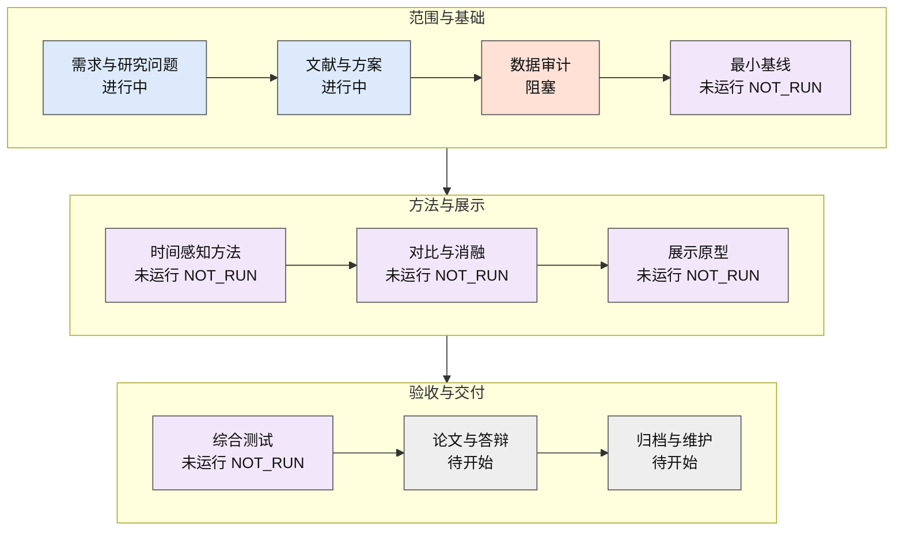

# 时间感知网络流量异常检测

本仓库管理“面向动态网络环境的时间感知流量异常检测方法研究”的技术文档、研究资料、程序源码和实验记录。目标是研究近期历史信息对异常检测误报、攻击识别和运行成本的影响，并形成可复核的实验与单机展示原型。


<!-- PROJECT-PROGRESS:START -->
## 项目当前进度

最近更新：**2026-11-13**。当前阶段：**数据审计**；本轮主题：AE内存接口及双视图人工工程验证已接受；研究仍S2/BLOCKED。



文字与颜色共同表示状态：已完成、进行中、待开始、阻塞、未运行。流程表示依赖顺序，部分文档与测试工作可交叉推进。

| 阶段 | 状态 | 已完成/总验收项 | 证据入口 | 下一步 |
|---|---|---|---|---|
| 需求与研究问题 | 进行中 | 1/3 | [清单与证据](<docs/project/ROADMAP.md>) | 用户选择C可行性方向；具体主数据/表示与导师审阅仍待登记 |
| 文献与方案 | 进行中 | 1/3 | [清单与证据](<docs/README.md>) | 精读并核对方法差异 |
| 数据审计 | 阻塞 | 1/4 | [清单与证据](<docs/project/DATA-GATE-2026-10-21.md>) | G13U发布记录供应已获准审计；待D1—D6协议与具体真实执行决定，原UGR证据保留，工程验收不放行Data Gate |
| 最小基线 | 未运行 NOT_RUN | 0/4 | [清单与证据](<src/README.md>) | 合成核心已在W1交付；真实最小基线等待Data Gate |
| 时间感知方法 | 未运行 NOT_RUN | 0/4 | [清单与证据](<src/README.md>) | 依基线证据确定窗口 |
| 对比与消融 | 未运行 NOT_RUN | 0/4 | [清单与证据](<experiments/README.md>) | 冻结统一评价协议 |
| 展示原型 | 未运行 NOT_RUN | 0/4 | [清单与证据](<src/README.md>) | 合成CLI/API/网页回放与导出一致；真实联调待Data Gate，研究验收不升级 |
| 综合测试 | 未运行 NOT_RUN | 0/3 | [清单与证据](<tests/README.md>) | 实现后风险契约验收 |
| 论文与答辩 | 待开始 | 0/3 | [清单与证据](<docs/README.md>) | 基于实验证据撰写 |
| 归档与维护 | 待开始 | 0/3 | [清单与证据](<docs/project/ROADMAP.md>) | 交付后复核版本清单 |

计数口径：2026-10-11阶段验收清单v1；按证据是否满足计数，维护工具测试不计入研究或业务验收。各项条件与证据见[状态源](docs/project/status.json)；文档存在不等于实现或实验通过。不合并为总体百分比；范围变化须登记新分母及原因。

**本次完成事项**

- 新增固定CPU自编码器内存接口，支持current13与h30_26，保留完整分钟轴和独立模型阈值。
- 175项专项替身测试及源码审查通过；原始人工A的两模型、十次更新、十二次前向验证经独立复核接受。
- 同一176分钟轴、56共同分钟、18训练及10独立校准；两表示的112分数、误差通道、严格预测及三类随机状态匹配。
- 本批未重复本地完整套件，安装态、保存重载和AE命令/页面尚未验收；源码快照的新CI待远端核对。
- 前批74ca91b已通过Desktop同步及三项准确CI；研究S2/Data Gate BLOCKED、真实训练及正式比较NOT_RUN保持。

**当前阻塞或待验证事项**

- 最终Attempted标签政策与有限试点协议尚未冻结；P_U相对P_B排除144个共同攻击分钟和293个正常候选，须先决定评价端点与敏感性范围。
- 共同正常训练/验证/独立校准仅150/88/148分钟，验证无攻击、校准历史重叠，99%尾部稳定性未验证；不按测试效果改参数或切分。
- 高完成流正常组P_U仅27分钟、最长3分钟；所有合格历史均含未解析源记录，持续高负载及artifact模型影响未验证。
- G13U只审计发布记录人口，精确生成/导出与物理协议不作认证；主数据采用、生产迁移、真实模型运行未获准，原UGR阻塞保持。

**接下来最重要的三项任务**

1. [ENG-R10](<docs/guides/release-autoencoder.md>)：完成本批Desktop同步和准确新CI，再决定AE结果包及只读inspect；已有两视图JSON可用于无拟合桥接，方案尚未采用。
2. [C-I5](<docs/research/2026-10-24-c17-g13u-audit.md>)：依据真实分母决定最终Attempted口径和有限试点约束；先固定协议，随后分别处理主数据正式采用与生产契约迁移。
3. [C-I7](<docs/project/DATA-GATE-2026-10-21.md>)：仅在相应批准和Gate证据满足后安排真实IF最小工程链路；本阶段训练/评分/阈值校准和正式实验继续NOT_RUN。

**最新成果入口**

- [AE内存接口与固定数值规则](<docs/guides/release-autoencoder.md>)
- [AE源码、专项测试和人工两视图验证](<docs/research/2026-11-13-release-autoencoder-verification.json>)
- [学习状态命令与只读查看接口设计](<docs/design/release-if-learned-workflows-v1.md>)
- [学习状态工作流源码及分项验证](<docs/research/2026-11-13-release-if-learned-workflow-verification.json>)
- [学习状态CLI独立人工安装验收](<docs/research/2026-11-13-release-if-learned-cli-verification.json>)
- [独立R2修订安装验收与旧失败分列](<docs/research/2026-11-12-release-if-learned-installed-r2.json>)
- [IF学习状态保存与显式复算](<docs/guides/release-if-learned.md>)
- [学习状态源码/完整回归与安装态分列验证](<docs/research/2026-11-12-release-if-learned-verification.json>)
- [学习状态三模块和固定包设计](<docs/design/release-if-learned-v1.md>)
- [G十例人工数值观察与父原始流证据缺口](<docs/guides/iforest-export-compatibility.md>)
- [G十例170项完整hex与有限接受证据](<docs/research/2026-11-12-iforest-export-compatibility-verification.json>)
- [前批F准确17文件Desktop发布与三CI回执](<docs/research/2026-11-11-iforest-numeric-state-publication.json>)
- [P1人工数值状态内存API及范围](<docs/guides/iforest-numeric-state.md>)
- [P1新安装四阶段与完整数值证据](<docs/research/2026-11-11-iforest-numeric-state-verification.json>)
- [P1固定JSON/矩阵/错误设计](<docs/design/iforest-numeric-state-v1.md>)
- [前批E准确Desktop发布与三CI回执](<docs/research/2026-11-11-release-if-evaluation-publication.json>)
- [保存预测的测试标签审计与null指标入口](<docs/guides/release-if-evaluation.md>)
- [只读新安装七阶段与完整标签报告验证](<docs/research/2026-11-11-release-if-evaluation-verification.json>)
- [固定预测三政策分母和错误边界](<docs/design/release-if-evaluation-v1.md>)
- [前批人工源完整链的准确Desktop发布与CI回执](<docs/research/2026-11-11-release-example-publication.json>)
- [固定人工CSV到IF与只读数据的完整复现入口](<docs/guides/release-example.md>)
- [新安装14阶段、数值与产物身份验收](<docs/research/2026-11-11-release-example-verification.json>)
- [人工CSV固定配方与排他创建协议](<docs/design/release-example-v1.md>)
- [前批IF命令的准确Desktop发布与CI回执](<docs/research/2026-11-11-release-if-result-cli-publication.json>)
- [公开IF结果生成、检查与输入绑定命令](<docs/guides/release-if-result-cli.md>)
- [13实际进程、新安装与完整数值保全验证](<docs/research/2026-11-11-release-if-result-cli-verification.json>)
- [公开IF命令接口与错误边界](<docs/design/release-if-result-cli-v1.md>)
- [前阶段结果包和只读页的准确发布回执](<docs/research/2026-11-11-release-if-results-publication.json>)
- [IF保存结果与独立重载、双视图只读页](<docs/guides/release-if-result-package.md>)
- [人工安装功能后验接受及原控制器失败](<docs/research/2026-11-11-release-if-results-verification.json>)
- [自包含结果包格式和信任边界](<docs/design/release-if-result-package-v1.md>)
- [启动前冻结的结果只读展示协议](<docs/design/release-if-result-view-v1.md>)
- [保存输入到隔离森林：实际人工安装运行及边界](<docs/guides/release-iforest-engineering.md>)
- [最终源回归、独立复核及失败保留记录](<docs/research/2026-11-10-release-iforest-engineering-verification.json>)
- [输入查看页两例实际浏览器与保全验收](<docs/research/2026-11-10-release-input-browser-verification.json>)
- [配对CLI独立安装四例验收](<docs/research/2026-11-10-release-pair-installed-verification.json>)
- [保存输入成对核对用法与验收限制](<docs/guides/release-model-input-pair.md>)
- [历史配对源码及当时浏览器未完成记录](<docs/research/2026-11-10-release-model-input-pair-verification.json>)
- [保存输入13/26维成对核对协议](<docs/design/release-model-input-pair-v1.md>)
- [输入包检查页入口、当前接受及历史失败](<docs/guides/release-input-viewer.md>)
- [输入包查看源码与首次安装后检查失败](<docs/research/2026-11-09-release-input-view-verification.json>)
- [输入包只读查看协议](<docs/design/release-input-view-v1.md>)
- [原始分钟包CLI运行与验收](<docs/guides/release-minute-cli.md>)
- [原始分钟包CLI实际验证记录](<docs/research/2026-11-07-release-minute-cli-verification.json>)
- [原始分钟包CLI协议](<docs/design/release-minute-cli-v1.md>)
- [准备输入三命令与实际退出](<docs/guides/release-input-cli.md>)
- [准备输入CLI人工验收与首轮失败](<docs/research/2026-11-07-release-input-cli-verification.json>)
- [准备输入CLI接口与退出边界](<docs/design/release-input-cli-v1.md>)
- [准备输入包保存与重放](<docs/guides/release-input-package.md>)
- [准备输入包实际人工验收](<docs/research/2026-11-07-release-input-package-verification.json>)
- [准备输入包13/26维格式](<docs/design/release-input-package-v1.md>)
- [原始分钟包保存与加载](<docs/guides/release-minute-package.md>)
- [原始分钟包实际验收](<docs/research/2026-11-07-release-minute-package-verification.json>)
- [原始分钟包格式](<docs/design/release-minute-package-v1.md>)
- [容量对照页面与接口](<docs/guides/candidate-capacity-viewer.md>)
- [容量页面实际验证](<docs/research/2026-11-07-candidate-capacity-viewer-verification.json>)
- [AE参数数量对照](<docs/guides/candidate-ae-capacity.md>)
- [容量对照实际验收](<docs/research/2026-11-06-candidate-ae-capacity-verification.json>)
- [真实试点准备复核](<docs/research/2026-11-06-pilot-readiness-review.md>)
- [小预算离线审计](<docs/guides/release-audit-cli.md>)
- [离线审计实际验收](<docs/research/2026-11-06-release-audit-cli-verification.json>)
- [发布记录与IF人工等价](<docs/guides/release-if-equivalence.md>)
- [文件适配与容量](<docs/guides/release-file-adapter.md>)
- [文件适配验证](<docs/research/2026-11-06-release-file-verification.json>)
- [发布格式人工适配](<docs/guides/release-format-adapter.md>)
- [格式与聚合验证](<docs/research/2026-11-06-release-format-verification.json>)
- [重建候选人工演示](<docs/guides/candidate-demo.md>)
- [人工演示实际验收](<docs/research/2026-11-06-candidate-demo-verification.json>)
- [候选同条件方法对照](<docs/guides/candidate-comparison-view.md>)
- [方法对照实际验证](<docs/research/2026-11-06-candidate-comparison-view-verification.json>)
- [候选完整测试评价查看](<docs/guides/candidate-evaluation-view.md>)
- [完整评价实际验证](<docs/research/2026-11-06-candidate-evaluation-view-verification.json>)
- [本轮持续开发计划](<docs/superpowers/plans/2026-11-06-autonomous-development.md>)
- [候选查看页本地启动](<docs/guides/candidate-viewer-launcher.md>)
- [候选启动命令实际验证](<docs/research/2026-10-31-candidate-viewer-launcher-verification.json>)
- [候选合成结果查看页](<docs/guides/candidate-viewer.md>)
- [候选查看页实际验证](<docs/research/2026-10-31-candidate-viewer-verification.json>)
- [候选合成结果只读HTTP](<docs/guides/candidate-readonly-http.md>)
- [候选HTTP与CLI实际验证](<docs/research/2026-10-31-candidate-readonly-http-verification.json>)
- [候选结果只读查看命令](<docs/guides/candidate-view-cli.md>)
- [候选查看CLI实际验证](<docs/research/2026-10-31-candidate-view-cli-verification.json>)
- [候选曲线范围分页](<docs/guides/candidate-series-pages.md>)
- [候选曲线分页实际验证](<docs/research/2026-10-31-candidate-series-page-verification.json>)
- [候选单分钟详情](<docs/guides/candidate-minute-details.md>)
- [候选分钟详情实际验证](<docs/research/2026-10-31-candidate-minute-detail-verification.json>)
- [候选运行分数只读快照](<docs/guides/candidate-run-snapshots.md>)
- [候选运行快照实际验证](<docs/research/2026-10-31-candidate-run-snapshot-verification.json>)
- [五类JSON同字节校验解析](<docs/guides/json-byte-consistency.md>)
- [五类JSON物理替换实际验证](<docs/research/2026-10-30-json-byte-verification.json>)
- [Parquet同字节校验解析及内存边界](<docs/guides/parquet-byte-consistency.md>)
- [三类物理替换实际验证](<docs/research/2026-10-30-parquet-byte-verification.json>)
- [最终导出字节与清单绑定](<docs/guides/export-byte-consistency.md>)
- [导出后读修复实际验证](<docs/research/2026-10-30-export-byte-verification.json>)
- [保存评价区间一致性与兼容边界](<docs/guides/backend-interval-consistency.md>)
- [区间校验测试与实际验收](<docs/research/2026-10-30-backend-interval-verification.json>)
- [合成通道的时间和字段绑定](<docs/guides/fake-channel-mapping.md>)
- [通道修复及四分钟API/mock对照](<docs/research/2026-10-30-fake-channel-verification.json>)
- [攻击片段与逐分钟漏报的区别](<docs/guides/episode-display.md>)
- [片段示例对齐与实际页面验证](<docs/research/2026-10-30-episode-example-verification.json>)
- [后端保存评价六项汇总核验与限制](<docs/guides/backend-evaluation-consistency.md>)
- [后端修复和三场景实际证据](<docs/research/2026-10-30-backend-evaluation-verification.json>)
- [候选IF/AE共同条件核查与指标汇总](<docs/guides/candidate-comparison.md>)
- [四个已存运行的只读核查证据](<docs/research/2026-10-30-candidate-comparison-verification.json>)
- [候选AE五JSON只读验算与证明范围](<docs/guides/candidate-ae-run-verification.md>)
- [六次实际复查与新增测试证据](<docs/research/2026-10-30-candidate-ae-run-verification.json>)
- [候选当前与历史AE人工运行及安全JSON权重](<docs/guides/candidate-ae-synthetic.md>)
- [三次实际人工AE、负例与测试证据](<docs/research/2026-10-30-candidate-ae-verification.json>)
- [候选IF五产物只读验算（不加载模型）](<docs/guides/candidate-run-verification.md>)
- [存储分数验算、证明范围与实际验证](<docs/research/2026-10-30-candidate-run-verification.json>)
- [候选13维IF人工评分、独立校准与三政策评价运行](<docs/guides/candidate-if-synthetic.md>)
- [候选IF实际产物、漏报负例与完整测试证据](<docs/research/2026-10-30-candidate-if-verification.json>)
- [已验证候选产物不可变快照与消费接口](<docs/guides/candidate-snapshots.md>)
- [快照单次读取、冻结与实际加载证据](<docs/research/2026-10-30-candidate-snapshots-verification.json>)
- [候选合成产物只读校验与搬迁复查](<docs/guides/candidate-artifacts.md>)
- [只读复查实际结果、失败回归与范围](<docs/research/2026-10-30-candidate-artifacts-verification.json>)
- [记录到分钟与13/26合成链路运行](<docs/guides/candidate-records.md>)
- [具体标签端点与有限试点决定包（推荐未批准）](<docs/research/2026-10-30-limited-pilot-proposal.md>)
- [10月30日实际链路和守恒证据](<docs/research/2026-10-30-candidate-records-verification.json>)
- [候选输入运行、计算规则与验证](<docs/guides/candidate-inputs.md>)
- [10月29日自主开发计划与报告映射](<docs/superpowers/plans/2026-10-29-candidate-inputs.md>)
- [人工CLI产物与1404项独立数值验证](<docs/research/2026-10-29-candidate-inputs-verification.json>)
- [G13U真实供应、标签分母与有限试点待决](<docs/research/2026-10-24-c17-g13u-audit.md>)
- [G13U完整聚合、守恒/身份与历史资格证据](<docs/research/2026-10-24-c17-g13u-audit.json>)
- [G13U获准供应审计与10月28日历史交接](<docs/guides/c17-g13u-supply.md>)
- [C17-I1实际获取与旧G12失败证据](<docs/research/2026-10-23-c17-i1-payload-audit.md>)
- [旧G12字段、标签、供应与资源聚合](<docs/research/2026-10-23-c17-i1-payload-audit.json>)
- [10月23日G12审计后历史提示与当时批准边界](<docs/guides/c17-i1-protocol-next.md>)
- [作者修订版获取准备历史与适配依据](<docs/research/2026-10-23-c17-improved-preparation.md>)
- [C17-I1审计工具与早期阶段历史提示](<docs/guides/c17-improved-audit.md>)
- [CICIDS2017适配性、样本风险与审计取舍](<docs/research/2026-10-23-cicids-suitability-analysis.md>)
- [GitHub数据来源检索与可获取镜像元信息](<docs/research/2026-10-23-github-dataset-search.md>)
- [C17官方入口、生成版本与C18-S本地一致性复核](<docs/research/2026-10-23-c17-source-metadata.md>)
- [10月23日C方向具体数据与表示决定包](<docs/project/CANDIDATE-DATA-DECISION-2026-10-23.md>)
- [CIC发行物、许可、时间与标签证据](<docs/research/2026-10-23-cic-candidate-evidence.md>)
- [候选文件身份、资源与已登记审计状态](<docs/research/2026-10-23-candidate-manifest.json>)
- [研究协议A/B/C对照与用户已选C方向](<docs/project/RESEARCH-PROTOCOL-OPTIONS.md>)
- [10月22日增量证据与候选元数据](<docs/research/2026-10-22-data-gate-evidence-update.md>)
- [Data Gate本轮分项判定与待决方案](<docs/project/DATA-GATE-2026-10-21.md>)
- [UGR与C方向早期验证准备记录（历史）](<docs/guides/real-validation-preflight.md>)
- [标签、时间与来源许可核查](<docs/research/2026-10-21-data-gate-label-audit.md>)
- [W0合成CLI/API/网页/导出联调证据](<docs/project/W0-SYNTHETIC-INTEGRATION-2026-10-21.md>)
- [合成系统快速运行](<docs/guides/quickstart.md>)
- [UGR16v3来源、标签与时区核验](<docs/research/2026-10-21-UGR16v3-provenance.md>)
- [W0三个模块交付接收与Data Gate复核](<docs/project/W0-DELIVERY-ACCEPTANCE-2026-10-21.md>)
- [W0-01契约交接与开发环境](<docs/project/W0-01-HANDOFF.md>)
- [并行开发计划V1.0与各work启动提示](<docs/superpowers/plans/2026-10-21-parallel-development.md>)
- [开题报告V0.40公开文本（15页、完整10图）](<docs/reports/开题报告-V0.40-公开文本.md>)
- [V0.40学习手册与十图讲解](<docs/reports/开题报告-V0.40-学习与答辩准备手册.md>)
- [答辩V0.24与讲稿、答疑（16页主讲）](<docs/reports/开题答辩-V0.24-公开文本.md>)
- [业务问题与研究主线及版本关系](<docs/reports/开题答辩-V0.24-结构与版本记录.md>)
- [W1交付、命令、真实审计与NOT_RUN边界](<experiments/W1-HANDOFF.md>)
- [滚动路线图、任务验收与依赖](<docs/project/ROADMAP.md>)
- [W2-01后端运行与验证说明（SYNTHETIC_ONLY）](<src/backend/README.md>)
- [W3前端安装、验证与NOT_RUN清单](<src/frontend/README.md>)

业务可运行版本与演示：**尚无，NOT_RUN**。仓库维护工具的可运行入口见[工具说明](tools/README.md)。远端自动检查以工作流徽章和实际运行记录为准；本轮提交前为**待远端检查**。
<!-- PROJECT-PROGRESS:END -->

## 从哪里开始

- [P1人工数值状态内存API](docs/guides/iforest-numeric-state.md)：安全JSON往返与双宽数学评分；[四阶段新安装验证](docs/research/2026-11-11-iforest-numeric-state-verification.json)已由主控后验接受，学习树导出/checkpoint仍未实施。
- [保存IF预测的只读测试标签审计](docs/guides/release-if-evaluation.md)：显式绑定保存结果和原输入，三种标签口径使用同一份预测；[七阶段新安装与完整验证](docs/research/2026-11-11-release-if-evaluation-verification.json)已通过独立后验复核并由主控接受，[E准确Desktop发布及三CI回执](docs/research/2026-11-11-release-if-evaluation-publication.json)已核对。
- [从固定人工CSV复现完整release链](docs/guides/release-example.md)：创建实际源与摘要配置，再显式运行raw、prepare、两个IF及只读数据服务；[14阶段验收](docs/research/2026-11-11-release-example-verification.json)已完成，新安装目录复用既有锁定依赖。
- [公开IF生成、检查与绑定命令](docs/guides/release-if-result-cli.md)：新安装后的两个实际人工视图、独立inspect/verify及有限API兼容检查已接受；[完整验证](docs/research/2026-11-11-release-if-result-cli-verification.json)区分模型、源码测试和研究范围。
- [保存结果与双视图只读页](docs/guides/release-if-result-package.md)：自包含结果、独立重载、API和实际浏览器功能经后验对账接受；原控制器失败及证据限制见[验证记录](docs/research/2026-11-11-release-if-results-verification.json)。
- [保存输入到隔离森林](docs/guides/release-iforest-engineering.md)：固定13/26维IF内存接口及前阶段人工双视图运行，结果保存与展示由上方新入口接续。
- [输入包检查页](docs/guides/release-input-viewer.md)：安装与保全、两例实际浏览器补验已接受；[早期安装后失败](docs/research/2026-11-09-release-input-view-verification.json)保留为历史，当前证据见[浏览器补验记录](docs/research/2026-11-10-release-input-browser-verification.json)。
- [文档导航](docs/README.md)：最新报告、答辩稿、设计基线及研究资料。
- [项目规划](docs/project/ROADMAP.md)：两周任务、中期里程碑与半年以上滚动路线。
- [状态源](docs/project/status.json)：阶段验收条件、已满足项与证据；首页进度由此生成。
- [决策与方案差异](docs/project/DECISIONS.md)：当前提案、历史基线和待确认影响。
- [风险与阻塞](docs/project/RISKS.md)：优先级、解除条件和处理任务。
- [仓库文件管理](docs/project/REPOSITORY_LAYOUT.md)：各分区职责及本地材料的入库方式。
- [开发与提交规范](CONTRIBUTING.md)：使用 GitHub Desktop 提交、推送和维护。
- [隐私与发布规则](docs/project/PRIVACY.md)：正文、文件名、元数据及提交身份检查。
- [变更记录](CHANGELOG.md)：已完成的仓库维护工作。

## 仓库分区

```text
docs/                 可发布技术文档、报告文本、研究资料和图形源文件
  project/            项目规划、状态、仓库管理和发布规则
  reports/            当前报告与答辩的脱敏文本
  baseline/           前期设计文档及版本历史
  research/           文献调研和来源记录
  figures/            可审阅的 SVG 图形源文件
src/                  检测核心、后端与前端实现
tests/                数据边界、算法和系统测试
configs/              可复用配置与无凭据示例
experiments/          实验协议及可发布结果摘要
data/                 数据来源与获取说明，原始数据本地保存
tools/                仓库检查与维护工具
.github/              文档与隐私检查流程
.githooks/            GitHub Desktop 提交前检查
```

`src/` 已有检测核心、后端和前端实现，合成CLI/API/网页与导出已形成最小闭环。前批固定人工CSV及摘要配置入口已在新安装目录完成14阶段的raw、prepare、两个IF、保存检查与HTTP兼容链。本轮新增保存预测只读标签审计，在新core安装目录完成七阶段验收；四个受控业务进程观察到模型fit/score/模型Q99均为0，另有6次保存分数Q99复核，完整回归的旧人工模型fixture另计。前阶段原控制器失败及后验接受分别保留。P1数值状态层现已完成新安装四阶段验收和12个人工case；775保护项与12fixture保持，首次完整回归41项setup前提失败及修复保留，新完整5112通过。首页阶段清单和真实业务交付的 `NOT_RUN` 指真实数据研究验收，不能用人工工程通过替代。历史文档保留当时状态；当前事实以状态源、对应运行指南和验证记录为准。

## 当前研究方案

核心问题仍是近期历史信息如何影响网络流量异常检测的误报、漏报与运行成本。原UGR16v3测试段没有正常候选，不能估计正常误报率；已选择优先核查替换主数据。作者修订CICIDS2017的G13U发布记录及候选13/26维表示已有审计，主数据正式采用、Attempted最终标签政策和真实有限试点协议仍待明确，详见[Data Gate](docs/project/DATA-GATE-2026-10-21.md)。候选实现不等于生产134/268维契约已迁移。

当前特征与过去窗口的中位数/MAD偏离仍是候选历史增强设计。IF、当前AE、历史增强AE已有人工工程实现；保存输入的IF消费者已接续自包含结果包、双视图只读页和公开run/inspect/verify命令。真实研究中的窗口、人口、校准及比较条件须按冻结协议执行；训练、验证、独立校准、测试保持时间顺序，测试不参与参数选择，历史先评分后更新。真实C17模型训练、评分、Q99校准和正式比较仍为NOT_RUN。

项目已有Python检测核心、FastAPI后端及Vue 3/TypeScript/ECharts前端。IF结果保存、独立重载、后端只读消费与结果页面已有实际人工功能证据，范围和原失败见[运行指南](docs/guides/release-if-result-package.md)。公开生成、检查及显式输入绑定命令已完成新安装人工验收。[固定人工CSV入口](docs/guides/release-example.md)现已接通完整显式链；CSV与配方可复现，spec绑定实际源路径。[保存预测的只读测试分钟评价](docs/guides/release-if-evaluation.md)已实现并通过新安装验收；三种标签口径按同一份保存预测分列误报、漏报和空指标原因。[P1数值状态层](docs/guides/iforest-numeric-state.md)已实现并通过新安装后验接受，仅处理手写森林状态；[IF学习状态保存与显式复算](docs/guides/release-if-learned.md)及其三类命令、六包只读页面均已通过分项人工安装验收，首次失败与后继成功分别记录。人工工程和真实研究分别验收。

## 本地维护

仓库检查工具仅依赖 Python 3.10 及以上版本的标准库：

```bash
python -X utf8 tools/repository/update_progress.py --write
python -X utf8 tools/repository/update_progress.py --check
python tools/repository/check_repository.py --worktree
python tools/repository/check_repository.py --staged
```

在 GitHub Desktop 中选择本仓库，查看 Changes、填写中文提交说明、提交到当前分支，再点击 Push origin。完成标准是远端分支与本地提交一致；单独的本地 Commit 不等于已同步。

原始 Office 文件、沟通记录、个人路径、数据和临时生成目录继续本地保留。本仓库只收录检查后的公开版本。当前报告文本由原稿抽取，保留段落和表格内容，不承诺复现学校排版；图片以单独图形源文件维护。第三方论文、数据和工具的授权仍以各自来源为准。

