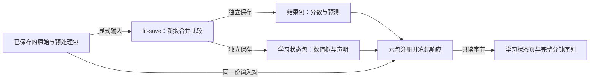

# 学习状态命令与只读查看入口 v1

用途：说明学习状态的显式命令、保存声明摘要和只读页面边界。日期：2026-11-13。状态：源码、人工 CLI 安装及页面独立v2安装/浏览器验收已接受；原失败保留，实际分项见[工作流验证](../research/2026-11-13-release-if-learned-workflow-verification.json)。依据：[学习状态包设计](release-if-learned-v1.md)、[使用指南](../guides/release-if-learned.md)、[CLI 验证记录](../research/2026-11-13-release-if-learned-cli-verification.json)。本设计不迁移原生产接口或134/268维契约，不批准真实研究运行。

两个视图各提供一对结果和学习状态包，共用同一输入对。上图展示人工工程链；页面不触发模型运行，真实研究仍等待 Data Gate。

## 三种显式命令

入口为 `python -m traffic_anomaly.release_if_learned_cli`。`inspect` 只接收学习状态包；`replay` 显式接收原始、预处理、结果和学习状态四个包；`fit-save` 接收原始及预处理包、一个固定视图和两个新输出目录。视图限 `current13`、`h30_26`。

帮助只需标准库。`inspect` 使用标准库学习状态编解码与磁盘读取，不导入 NumPy、模型或 pickle。`replay` 使用显式输入和数值树评分，不重新拟合模型或预处理；NumPy 自身的初始化导入与产品 pickle 操作分别核查。`fit-save` 到达拟合步骤后启动一次新的显式拟合；成功命令比较完整公共分数，并各调用一次结果保存和学习状态保存。参数或输入检查失败可能在拟合前返回。

参数、绝对路径及输入输出布局在相应昂贵操作前检查。两个输出不能相同、重叠或覆盖输入，最终目录竞争仍以排他创建裁定。两次保存分别完成；第二次失败可能留下完整结果包，输出失败也可能发生在两个包都已保存之后。命令保留残留，不回滚、不覆盖、不自动重试。

业务命令的成功输出是有界的 UTF-8 JSON 加一个 LF，最多32768字节；单独的帮助命令输出固定文本。失败使用有限错误码，不输出外部异常详情。成功回执的 `operations` 描述本次适配器操作，包的来源和模型历史认证状态仍保持原值。

## 学习状态摘要

`summarize_release_if_learned(package)` 先经真实编解码规则验证，再返回新建的基础值对象。其规范 UTF-8 JSON 编码连同末尾 LF 最多16384字节，这一上限不表示 Python 对象的内存大小。它投影学习状态、输入及结果引用、特征顺序、配置、树与节点计数和检查状态。摘要不包含树节点载荷、分数、掩码、矩阵或本地路径。

结构摘要中的 `numerical_replay=NOT_RUN`、输入及结果绑定 `NOT_PERFORMED` 保留原义。之后一次显式复算成功，也不会把该结构摘要重新标为已复算或已认证。

## 六包注册与固定响应

`create_release_if_learned_view_app(raw, prepared, current13_result, current13_learned, h30_26_result, h30_26_learned)` 按此顺序显式接收六个包。注册阶段核对完整身份、输入配对、结果资格、配置、特征顺序、分钟索引集合的摘要和学习状态声明。它可构造矩阵并复核已保存分数的 Q99；这些检查不属于新的模型拟合、模型评分或预处理估计，也不进行数值树复算。

注册成功后冻结所有响应。普通 GET 不再读取输入文件，不重新验证包、构造矩阵、拟合、评分或计算摘要。服务组合既有结果页与完整分钟序列接口，同时新增：

| 路径 | 内容 |
|---|---|
| `/release-if-learned/v1/summary` | 两个视图的学习状态摘要及六包绑定声明 |
| `/release/learned` | 查看页 |
| `/release/learned/learned.mjs` | 固定脚本 |
| `/release/learned/learned.css` | 固定样式 |

新元信息最多65536字节，三个资源各最多65536字节；新元信息、三个资源及固定错误正文合计最多262144字节，原结果页预算保持。脚本、样式逐项进入包资源清单，不使用通配符。响应使用 `no-store`、`nosniff`，HTML 使用同源内容策略。四个新增路径拒绝所有查询参数；保留的 `/release-if/v1/series` 接受有效页码，例如 `?page=0`。非 GET 和未知路径返回有限错误。

新摘要的 `snapshot_sha256` 覆盖仅去掉自身的整个排序 JSON 对象，保留 `result_snapshot_sha256`，使用 UTF-8、紧凑分隔符并以一个 LF 结束。两个视图声明中的 `max_features` 在规范字节中为 `1.0`。旧结果摘要的哈希输入是三个顶层字段组成的对象：固定 `profile_id="c17-release-iforest-view-v1"`，以及 `current13`、`h30_26` 的完整结果身份对象；同样按排序键、紧凑 UTF-8 JSON 加一个 LF 编码。页面分别验证两种规则并核对共同结果引用。

## 页面与前台服务

页面同时读取新摘要和既有结果摘要，验证封闭结构、有限数值、身份、各组分钟数及摘要后显示两张视图卡片。测试段总分钟数、测试段共同有效分钟数，以及训练、校准和预处理拟合分钟数分别展示，不将全角色公共数用作测试分母。树节点、矩阵、路径和授权材料不传给浏览器；页面不能触发拟合或复算。

两个摘要请求有各自的字节上限，并共享一个10秒截止时间，覆盖读取、验证直至页面提交。迟到响应与读取器被清理，失败只显示有限状态并允许重新读取；重新读取不执行模型。卸载和重入时，旧请求不得覆盖新页面。

`python -m traffic_api.release_if_learned_serve_cli` 接收六个绝对包路径，只监听 `127.0.0.1`，默认端口8769。`--serve-seconds` 为1—300秒，默认300；READY 写出并刷新后开始计时，到期请求停止。关闭阶段有协作式超时；启动器没有独立强制进程退出的硬时限。STOPPED 仅在正常关闭及清理后输出，实际退出及退出码须由调用进程观测。异常保留首个失败，不用后续清理错误覆盖它。帮助不加载数值库或服务器。

## 验证与研究范围

源码验证分别覆盖命令冷启动、路径竞争、部分保存、有限错误、冻结请求、浏览器异步清理和 Python/JavaScript 规范字节。人工 CLI 安装验收使用原始保存 A，每视图56项、两个视图合计112项；原始评分、拟合侧 P1 与独立复算逐项一致。实际服务器与浏览器的状态以独立运行记录为准，源码测试不代替安装或浏览器观察。

摘要和绑定检查只证明已保存材料的内部一致性。`source_authentication`、模型来源及推导重放的限定不变。首次安装观察失败、独立 R2 成功和历史 G 的父进程原始流缺口分别保留；新命令成功不改写旧记录。研究仍处于 S2，Data Gate 为 BLOCKED，真实训练、评分、阈值校准和正式比较为 NOT_RUN。
