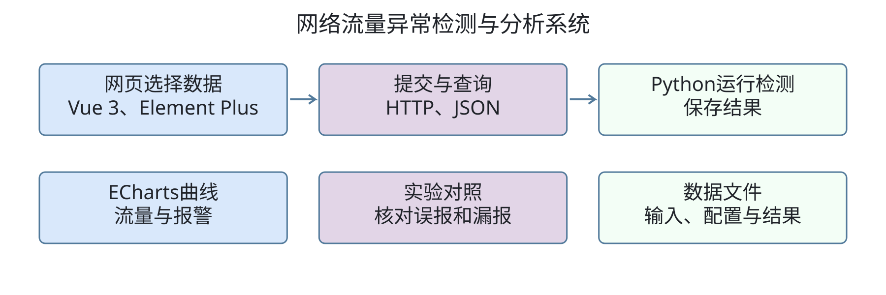
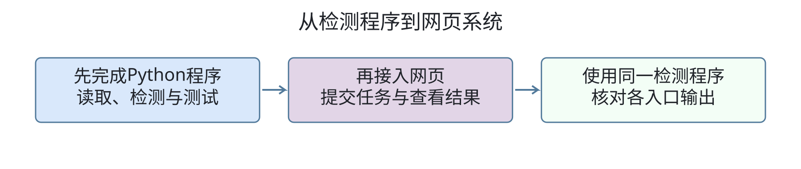
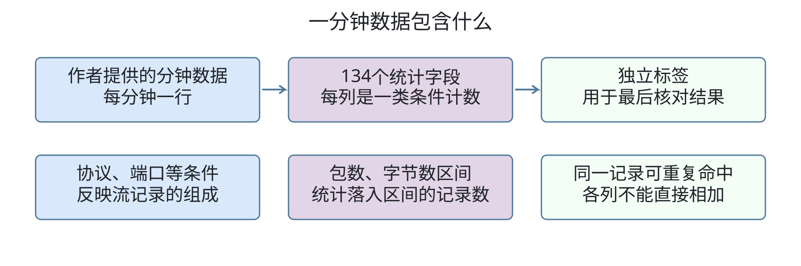
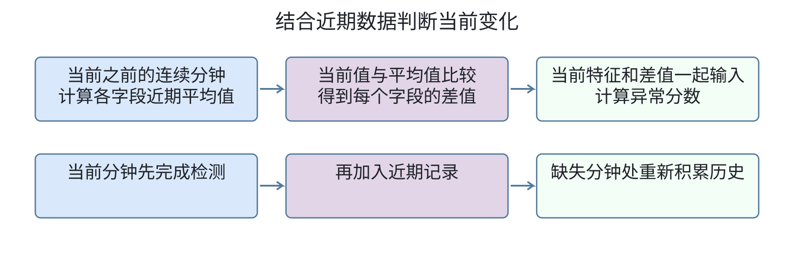
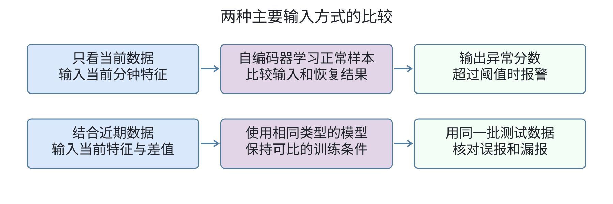
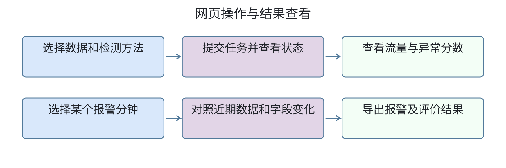
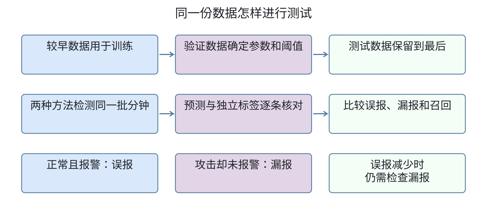

# 开题报告 V0.36 公开文本

2026-10-15；技术与范围收缩草稿，待审阅。11页、7图、无公式。保留Python、scikit-learn、PyTorch及已熟悉的前端工具；撤下USAD、MAD与具体后端存储选型承诺。近期均值差值是本版拟采用的简化方法，尚未验证效果。数据、训练、实验与系统实现NOT_RUN。

1．课题来源及研究的目的和意义

1.1 课题背景

随着视频播放、直播、网络游戏和云服务的普及，网络需要持续处理不同类型的访问请求。不同业务的流量变化并不相同：视频平台在热门节目播出时访问量增加，游戏服务在版本更新或活动开始后出现集中访问，云服务也会随用户工作时间和任务规模发生负载变化。这些变化属于正常业务活动，但在部分流量指标上，可能表现出与攻击相似的突然增长。

微软、腾讯、字节跳动等企业，其相关业务不仅需要保障服务能够承受正常访问高峰，还需要识别和处置恶意流量。网络流量异常检测不能只判断流量是否变大，还需要结合协议、端口及其他特征，分析当前变化是否偏离正常行为。例如，某一分钟的TCP流量计数较高，可能与正常业务增长有关，也可能与异常活动有关，仅凭这一项指标难以直接确定原因。

本课题以UGR16分钟流量为研究对象[1]，考察近期历史信息能否为当前流量判断提供补充依据。在分析当前分钟特征的同时，计算这些特征相对前一段时间的变化，再通过对照实验检验加入历史信息后能否减少正常波动的误报，并保持攻击检出能力。研究同时考虑数据与实际应用条件之间的差异[2]，在此基础上开发网络流量异常检测与分析系统。

1.2 研究的目的和意义

本课题拟开发网络流量异常检测与分析系统，读取公开分钟数据，标出可疑时间段，在网页中展示流量与报警。用户可以查看报警分钟的字段变化，结合标签核对结果。系统总体设计如图1-1所示。

图1-1  系统总体设计

系统主要判断某一分钟的数据是否可疑。输入数据已经按分钟汇总，因此检测结果定位到时间段，不直接定位某一条连接，也不根据异常分数确定攻击类型。

自编码器在网络异常检测中已有应用[3]。本课题比较只看当前数据与结合近期数据两种输入，在相同条件下测试，检查加入近期数据后误报是否减少、攻击是否漏掉更多。最终形成可导入数据、执行检测及查看结果的系统，并说明近期数据对检测的帮助与局限。

2．国内外在该方向的研究现状及分析

2.1 国外现状及分析

随着网站和在线应用向云平台迁移，企业需要同时应对用户集中访问和恶意流量冲击。亚马逊、微软与谷歌陆续将流量监测及攻击防护接入云服务，保障业务持续运行。

2016年，亚马逊推出AWS Shield，与负载均衡、CloudFront内容分发网络及Route 53域名服务配合，为云上应用提供分布式拒绝服务攻击（DDoS）防护。其业务逻辑是在用户访问链路中检测和缓解攻击，减少恶意请求对网站及应用的影响。[4]

微软Azure DDoS Protection持续分析应用流量，依据业务画像调整防护配置。微软公布的案例显示，2021年8月，一家欧洲客户遭遇峰值2.4 Tbps的DDoS攻击，平台通过防护机制保障业务运行。该方案将业务平时的流量表现作为判断与防护的参考。[5][6]

2023年，谷歌公布了峰值每秒3.98亿次请求的HTTP/2攻击案例。谷歌通过边缘防护设施与针对性措施缓解攻击，并为采用负载均衡和Cloud Armor的客户提供相关保护。此类攻击通过密集请求消耗处理能力，说明检测除关注流量规模，还需分析协议行为。[7]

上述产品把检测与业务访问链路结合，并考虑应用自身的运行情况。流量监测逐步服务于攻击发现、告警调查和业务连续性保障。

2.2 国内现状及分析

网络游戏、视频直播和在线交易的发展，使国内互联网平台既要保障正常访问高峰，也要防范恶意流量。腾讯、字节跳动和哔哩哔哩围绕不同业务，开展了攻击防护与高负载保障实践。

腾讯云将游戏版本发布、重大赛事直播和电商大促列为DDoS防护场景。这些业务在特定时段需要持续承接用户访问，攻击可能造成连接失败或服务中断。其产品支持按需调整防护能力，使业务方能够结合日常运行和活动安排配置防护资源。[8]

字节跳动通过旗下火山引擎向外部企业提供云服务。其DDoS原生防护将游戏列为典型场景，为云上公网业务提供常态化网络层防护，并可联动高防服务应对大流量攻击。业务处理由日常监测延伸到攻击期间的流量防护，以维持服务器可用性。[9][10]

哔哩哔哩的公开实践体现了正常高峰下的流量分析。2024年S14赛事期间，直播团队记录前期比赛的在线人数与技术指标，预估后续比赛资源，并通过压测核验容量[11]。2025年春晚直播保障中，团队模拟开播洪峰检验扩容、限流方案，核心播放服务采用双机房部署，异常时调整流量分配[12]。这些案例属于正常业务保障，不能作为攻击检测效果的证据。

上述业务共同要求识别流量变化的原因：高负载可能来自正常活动，也可能包含攻击。本课题拟结合当前数据与近期变化分析分钟流量，通过统一测试比较误报和漏报，并提供异常分钟及相关字段的回看。

3．主要研究内容

3.1 研究内容

本课题使用Python完成数据处理与异常检测，使用Vue 3开发结果展示页面。主要研究内容如下。

（1）读取UGR16分钟数据，核对字段和标签，处理乱序、重复及缺失记录，按时间先后划分数据。

（2）使用scikit-learn实现隔离森林对照，使用PyTorch实现自编码器，比较只看当前数据和结合近期数据的检测结果。

（3）在相同测试数据上核对误报和漏报，分析正常高负载及持续攻击片段。

（4）开发数据选择、检测任务、曲线展示和结果导出功能。检测程序与网页调用关系如图3-1所示。

图3-1  检测程序与网页调用关系

3.2 拟解决的关键问题

3.2.1 数据与特征相关问题

（1）弄清每个字段统计的内容，保证数据与标签按分钟对应。（2）区分真实的零计数与缺失记录，避免重复记录影响统计。

3.2.2 检测方法相关问题

（1）明确近期数据如何参与当前判断。（2）在相同条件下训练和测试，检查误报减少时是否出现更多漏报。

3.2.3 系统开发相关问题

（1）完成Python检测程序与网页之间的数据交互。（2）保证页面曲线、报警记录和导出结果一致。

4.  研究方案

4.1 拟采取的研究方法和技术路线

拟通过软件工程方法开展研究，首先分析系统需求，确定各模块功能，再设计数据处理与页面交互流程。在此基础上编写程序，先完成数据导入和检测，再开发网页，最后通过联调和测试检查功能。

检测部分采用Python开发，使用scikit-learn实现隔离森林，使用PyTorch实现自编码器。网页采用Vue 3、TypeScript与Element Plus，使用ECharts绘制曲线，通过HTTP和JSON与Python程序交换数据。检测结果和运行配置保存为文件，具体接口框架及存储工具在开发时按需要确定。

开发使用Visual Studio Code，借助venv管理Python环境，使用Node.js、npm和Vite运行及构建前端。代码通过Git管理，使用GitHub Desktop提交与同步，使用pytest检查数据处理和检测输出。具体技术路线如下。

4.1.1 数据读取与检查

本课题优先使用作者提供的UGR16v3分钟特征数据[13][14]。每分钟对应一行，包含134个统计字段，各列表示满足某类地址、协议或端口条件的流记录数量，也包含按包数和字节数区间统计的记录数。数据含义如图4-1所示。

图4-1  分钟数据与统计字段

例如，一条流记录可能同时属于TCP协议和某个端口类别，因此不同列可以同时增加，各列相加不能直接作为总流量。包数区间列表示落入该区间的流记录条数，也不能直接作为总包数。标签单独保存，只在最终核对检测结果时使用。

数据检查先核对字段顺序、时间范围和标签对应关系。乱序记录按时间排序，特征与标签同步移动；疑似重复记录需核对来源与内容，内容冲突的记录先单列。缺少某一分钟或字段时，不直接填零，该记录暂不用于主要评价，并记录排除原因和数量。

数据按时间顺序划分为训练、验证和测试三部分。训练数据用于学习正常模式，验证数据用于选择设置和确定报警阈值，测试数据保留到最后。需要对不同大小的计数作统一处理时，处理参数仅由训练数据确定，再应用于后续数据。

4.1.2 近期数据的使用方法

拟先使用当前分钟之前15个连续有效分钟作为参考，计算每个字段在这段时间内的平均值，再用当前值减去该平均值，得到当前相对近期水平的差值。当前字段与相应差值共同作为模型输入，流程如图4-2所示。

图4-2  结合近期数据的检测流程

例如，某个字段近期平均计数为100，当前计数为140，则差值为40。这个差值描述当前相对近期增加了多少，是否属于异常仍由检测模型判断，并在测试中核对标签。各字段的计算使用相同的数据处理口径。

持续攻击也可能进入近期记录，使平均值逐渐升高，需要在测试中检查是否因此漏报。当前分钟完成检测后，才加入后续计算的近期记录。遇到分钟缺口时，重新积累连续数据，积累不足的记录暂不参加主要比较。实验以15分钟为起点，再比较30分钟，观察参考时间长短是否影响误报和漏报；具体设置在验证数据上确定，测试时保持不变。

4.1.3 异常检测方法

隔离森林作为基础对照方法[15]，通过scikit-learn调用并保存检测结果。主要比较使用自编码器的两种输入方式：一种只输入当前分钟的134个字段，另一种输入当前字段及其相对近期平均值的差值。两种方式如图4-3所示。

图4-3  两种输入方式的比较

自编码器通过正常样本学习输入数据的特征关系，再尝试恢复输入。检测时比较输入与恢复结果之间的差距，差距较大的分钟得到较高异常分数。报警阈值根据验证数据确定，超过阈值时标记为可疑分钟。具体网络层数和训练参数在实现时验证，不在开题阶段认定为最优设置。

两种输入使用相同类型的网络，尽量保持接近的模型规模和相同的训练条件，采用相同的阈值选择办法。模型训练和参数选择完成后，测试阶段固定模型及阈值，不利用测试标签反复调整结果。

4.1.4 网页开发与结果保存

网页设置数据选择、检测任务、异常分析和结果对比等功能。用户选择数据与方法后提交任务，Python程序执行检测，网页显示执行状态，完成后读取结果。操作过程如图4-4所示。

图4-4  网页操作与结果查看

前端使用Element Plus提供表单、按钮和结果表格，使用ECharts绘制流量与异常分数。曲线和报警记录按同一时间对应，用户可以选择某个报警分钟，查看当前计数及近期平均水平。字段变化只作为核查线索，不直接认定为攻击原因。

每次检测保存所用数据范围、方法和主要设置，并保存逐分钟分数及报警结果。通过HTTP和JSON传递任务请求及结果，检测程序同时保留直接运行的入口，方便检查网页结果是否与程序输出一致。

4.1.5 对照实验与测试评价

测试先固定数据的时间划分，再分别训练和验证只看当前数据、结合近期数据的两种方法，最后让它们检测同一批测试分钟。隔离森林在相同的数据范围内运行，作为补充参照。实验流程如图4-5所示。

图4-5  对照实验与结果核验流程

将每分钟的报警结果与独立标签逐条核对。正常分钟却报警，记为误报；攻击分钟没有报警，记为漏报。统计精确率、召回率、F1和误报率，同时列出具体误报和漏报片段，便于回看。各方法使用共同有效的分钟，缺失和标签不确定的记录不混入比较。

重点检查两类片段：一类是标签为正常、但TCP或UDP计数较高的分钟，另一类是持续攻击片段。高计数范围依据训练正常数据确定，例如取计数最高的一成作为参考范围，再将对应边界固定用于测试。正常高负载误报和各类攻击召回分别统计，持续攻击还需观察报警是否延迟。

若加入近期数据后误报减少，并且没有漏掉更多攻击，才说明该方法在本次测试中有帮助；如果误报减少但漏报增加，应如实说明这一取舍。比较15分钟与30分钟时重新训练和验证，保留各次设置与结果，不通过更换测试片段选择较好的结论。

系统测试检查数据导入、任务提交、曲线展示和结果导出。使用少量可手工核对的数据检查计数、报警和指标，再比较直接运行程序与网页的输出。还要检查修改未来数据或标签后，已经计算的分数是否保持不变，以及重复加载同一模型后结果是否一致。记录运行时间和内存占用，说明系统能否在现有设备上完成检测。

5．进度安排，预期达到的目标

5.1 进度安排

本课题计划于2026年10月15日开始，2027年5月31日结束，具体进度安排如表5-1所示。

表5-1　进度安排

| 序号 | 起止时间 | 计划工作内容 |

| 1 | 2026.10.15—2026.10.31 | 对毕设题目进行需求分析与系统设计 |

| 2 | 2026.11.01—2026.11.30 | 完成数据核验、预处理及历史特征计算模块 |

| 3 | 2026.12.01—2026.12.31 | 完成隔离森林及自编码器检测模块 |

| 4 | 2027.01.01—2027.01.31 | 完成结合近期数据的自编码器开发 |

| 5 | 2027.02.01—2027.02.28 | 完成评价模块，开展模型与历史窗口对照实验 |

| 6 | 2027.03.01—2027.03.31 | 完成Python接口、任务管理及结果保存功能 |

| 7 | 2027.04.01—2027.04.15 | 完成前端页面及流量、报警结果展示功能 |

| 8 | 2027.04.16—2027.04.30 | 完成前后端联调及系统功能、性能测试 |

| 9 | 2027.05.01—2027.05.15 | 整理实验结果，修改毕业论文，准备验收 |

| 10 | 2027.05.16—2027.05.31 | 完成论文定稿，准备系统演示及毕业答辩 |

5.2 预期达到的目标

（1）系统可以导入分钟级网络流量数据，完成数据检查、特征处理和时间划分。

（2）检测模块可以运行隔离森林和自编码器，计算异常分数并标记可疑分钟。

（3）历史增强检测模块可以结合当前数据与近期历史，判断流量是否出现异常。

（4）后端可以管理检测任务，保存运行状态、模型配置及检测结果。

（5）用户可以通过网页选择数据和检测方法，查看流量曲线、报警记录及相关特征变化。

（6）评价模块可以将检测结果与数据标签对照，统计误报率、召回率和F1等指标。

（7）系统可以对比不同方法和历史窗口的检测结果，并导出评价指标及报警记录。

6．课题已具备和所需的条件、经费

6.1 已具备条件

（1）台式计算机一台。

（2）ThinkPad笔记本电脑一台。

6.2 所需条件

（1）Python及PyTorch开发环境。

（2）Vue 3与Python网页开发环境。

（3）网络流量数据集及相关资料。

（4）网络流量分析、机器学习及网页开发的相关知识。

6.3 经费

本课题拟使用现有计算机、公开数据集和开源软件，暂无新增设备购置计划。如需增加存储空间或算力，再根据实际需求核算经费。

7．研究过程中可能遇到的困难和问题，解决的措施

（1）对数据集中的部分字段和标签理解不够清楚，可能影响后续检测。拟通过查阅数据说明和相关资料，结合实际数据逐步核对。

（2）对部分检测算法和开发工具不够熟悉，实现时可能遇到困难。拟参考开源代码和官方教程，先完成简单功能，再逐步完善。

（3）前后端连接后可能出现结果显示不正确或运行较慢的问题。拟分模块检查和测试，定位问题后修改，保证系统能够正常使用。

8．主要参考文献

[1] MACIÁ-FERNÁNDEZ G, CAMACHO J, MAGÁN-CARRIÓN R, et al. UGR’16: A new dataset for the evaluation of cyclostationarity-based network IDSs[J]. Computers & Security, 2018, 73: 411–424. DOI: 10.1016/j.cose.2017.11.004.

[2] SOMMER R, PAXSON V. Outside the Closed World: On Using Machine Learning for Network Intrusion Detection[C]//2010 IEEE Symposium on Security and Privacy. 2010: 305–316. DOI: 10.1109/SP.2010.25.

[3] MIRSKY Y, DOITSHMAN T, ELOVICI Y, et al. Kitsune: An Ensemble of Autoencoders for Online Network Intrusion Detection[C]//Network and Distributed System Security Symposium. 2018. DOI: 10.14722/ndss.2018.23204.

[4] AMAZON WEB SERVICES. AWS Shield – Protect your Applications from DDoS Attacks[EB/OL]. (2016-12-01)[2026-10-14]. https://aws.amazon.com/blogs/aws/aws-shield-protect-your-applications-from-ddos-attacks

[5] MICROSOFT. Azure DDoS Protection fundamental best practices[EB/OL]. [2026-10-14]. https://learn.microsoft.com/en-us/azure/ddos-protection/fundamental-best-practices

[6] MICROSOFT. Business as usual for Azure customers despite 2.4 Tbps DDoS attack[EB/OL]. [2026-10-14]. https://azure.microsoft.com/en-us/blog/?p=87

[7] GOOGLE CLOUD. Google mitigated the largest DDoS attack to date, peaking above 398 million rps[EB/OL]. (2023-10-10)[2026-10-14]. https://cloud.google.com/blog/products/identity-security/google-cloud-mitigated-largest-ddos-attack-peaking-above-398-million-rps

[8] 腾讯云. DDoS防护：应用场景[EB/OL]. [2026-10-14]. https://cloud.tencent.com/document/product/297/137985

[9] 火山引擎. 为什么选火山[EB/OL]. [2026-10-14]. https://www.volcengine.com/about

[10] 火山引擎. DDoS原生防护[EB/OL]. [2026-10-14]. https://www.volcengine.com/product/AntiDDoS-basic

[11] 哔哩哔哩技术. B站直播S14保障全解析：高效保障技术实践[EB/OL]. (2024-11-15)[2026-10-14]. https://www.bilibili.com/opus/999887666627477509

[12] 哔哩哔哩技术. 2025 B站春晚直播——技术保障复盘[EB/OL]. [2026-10-14]. https://www.bilibili.com/opus/1045532478810357782

[13] CAMACHO J, RODRÍGUEZ-GÓMEZ R A. Data Quality Tools to Enhance a Network Anomaly Detection Benchmark[J]. Data, 2025, 10(3): 33. DOI: 10.3390/data10030033.

[14] CAMACHO J. UGR16_FeatureData: Feature data at one-minute intervals from the UGR’16 dataset[DB/OL]. [2026-10-09]. https://github.com/josecamachop/UGR16_FeatureData.

[15] LIU F T, TING K M, ZHOU Z H. Isolation Forest[C]//2008 Eighth IEEE International Conference on Data Mining. 2008: 413–422. DOI: 10.1109/ICDM.2008.17.
